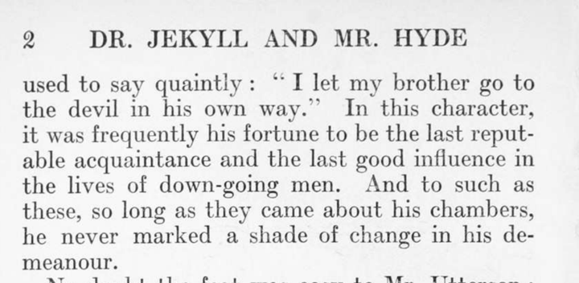

# inkthaw

Turn scanned PDFs into clean, reflowable EPUBs. Open source (Apache-2.0),
free, self-hostable.

```
PDF ─► ingest ─► rasterize ─► preprocess ─► ocr ─► cleanup ─► build ─► validate ─► EPUB + report
```

Every stage writes its own folder inside `jobs/<slug>/`, so runs are
resumable and every intermediate file can be inspected. See [PLAN.md](PLAN.md)
for the design and roadmap.

> **Status: 0.2.0, alpha.** Scan in, valid EPUB 3 out, with cleanup rules,
> a quality report that points at the pages worth checking, and a Docker
> watch-folder service. See the [changelog](CHANGELOG.md) for what works and
> what doesn't yet.

## Before and after

Two scanned pages of *Strange Case of Dr. Jekyll and Mr. Hyde* (public domain,
[Internet Archive](https://archive.org/details/strangecaseofd00stevuoft)):

<p>


</p>

The end of the paragraph that runs across the page break, as it appears in the
EPUB:

> But he had an approved tolerance for others; sometimes wondering, almost with
> envy, at the high pressure of spirits involved in their misdeeds; and in any
> extremity inclined to help rather than to reprove. “I incline to Cain’s
> heresy,” he used to say quaintly: “I let my brother go to the devil in his own
> way.” In this character, it was frequently his fortune to be the last reputable
> acquaintance and the last good influence in the lives of down-going men. And to
> such as these, so long as they came about his chambers, he never marked a shade
> of change in his demeanour.

The paragraph is joined across the page break; the running header and page
number are gone; "reput-able" and "de-meanour" are rejoined while "down-going"
keeps its hyphen; quotes are curled and the old spacing before `:` and `;` is
removed. The chapter becomes an EPUB chapter, and the title lines are kept as
front matter. Not everything is this clean: on the full book the text is about
98.2% accurate by character ([benchmarks](docs/benchmarks.md)), and the report
lists the pages that need a look.

## Run with Docker

The easiest way to run inkthaw is the watch-folder service:

```bash
docker compose up -d
```

Drop PDFs into `./inbox`; EPUBs appear in `./outbox`. Each book's job folder,
including its `report.html`, is kept in `./jobs/<slug>/`. Processed PDFs move
to `inbox/done/` (or `inbox/failed/` with an `outbox/<slug>.error.txt`). To set a
book's title, author or profile, put a TOML file with the same name next to the
PDF before dropping it, e.g. `inbox/my-book.toml`:

```toml
profile = "nonfiction"
[metadata]
title = "My Book"
authors = ["Jane Author"]
```

On first start the model weights (about 700 MB) are downloaded into `./models`
and reused afterwards. The container runs as UID/GID 1000 by default; set
`INKTHAW_UID` / `INKTHAW_GID` to match the owner of these folders. For an NVIDIA
GPU (needs the NVIDIA Container Toolkit and a driver that supports CUDA 13.2):

```bash
docker compose --profile gpu up -d inkthaw-gpu
```

One-off conversion without the watcher:

```bash
docker compose run --rm inkthaw run /data/inbox/book.pdf --out /data/outbox --jobs-dir /data/jobs
```

## Requirements (without Docker)

- Python 3.12 or newer. That is all that is required: PDF rendering (PDFium,
  via `pypdfium2`), page clean-up (deskew, border removal, despeckle) and the
  EPUB 3 writer run inside inkthaw, so poppler, unpaper and pandoc are no longer
  needed.
- Optional: [EPUBCheck](https://www.w3.org/publishing/epubcheck/) and a Java
  runtime. When they are missing, the EPUB is still built and the report says
  that validation was skipped.
- Optional: unpaper, as an alternative preprocess backend
  (`preprocess.backend = "unpaper"`), and [pandoc](https://pandoc.org/) ≥ 3.0
  as an alternative EPUB builder (`build.backend = "pandoc"`).

To validate EPUBs, on macOS (Homebrew):

```bash
brew install epubcheck
```

Debian / Ubuntu:

```bash
sudo apt install epubcheck default-jre-headless
```

On a Mac, run inkthaw natively rather than in Docker: Docling then uses the
GPU (MPS), about twice as fast as the CPU-only container.

## Install and check

From PyPI (once published; see the [changelog](CHANGELOG.md)), with
[uv](https://docs.astral.sh/uv/) or pipx:

```bash
uvx --from 'inkthaw[docling]' inkthaw run book.pdf
```

```bash
pipx install 'inkthaw[docling]'
```

On Linux, PyPI's torch wheel is the CUDA build (about 2.5 GB); the Docker CPU
image is the smaller option there.

From a checkout:

```bash
uv sync --extra docling
```

```bash
uv run inkthaw doctor
```

`doctor` lists the built-in PDF and image libraries and each external tool
with its version, and says what is missing.
`inkthaw engines` lists OCR engines and the devices they can use (CUDA, MPS,
CPU). By default model weights are downloaded into the engines' own caches on
first use; to keep them in one folder (and run offline afterwards), set
`models_dir` in `inkthaw.toml` or `INKTHAW_MODELS_DIR`, then:

```bash
uv run inkthaw models
```

The watch-folder mode also works without Docker:

```bash
uv run inkthaw watch ./inbox --out ./outbox
```

## Convert a book

```bash
uv run inkthaw run book.pdf --title "The Book" --author "Jane Author"
```

The EPUB is copied to `out/<slug>.epub`. The job folder keeps everything:

```
jobs/<slug>/
  manifest.json        input hash, config snapshot, stage status, timings, tool versions
  00_source/           input.pdf, info.json (page geometry, scan DPI, text-layer check)
  10_pages/            rendered page images (spreads split), cover.png
  20_clean/            cleaned page images (deskewed, borders and specks removed)
  30_ir/raw.json       BookIR straight from the engine (+ per-page cache)
  40_ir/clean.json     BookIR after cleanup (+ changes.json)
  50_build/            book.epub (+ book.md, metadata.yaml with build.backend = "pandoc")
  60_report/           report.json, report.html, epubcheck.json
```

Running the same command again skips stages whose inputs and settings did not
change. To redo part of the pipeline (for example after editing
`40_ir/clean.json` by hand):

```bash
uv run inkthaw run book.pdf --from build
```

An interrupted OCR run resumes page by page. `inkthaw report jobs/<slug>` shows
each stage's status.

## What cleanup does

Each rule can be switched off in `[cleanup]` and records its edits in
`40_ir/changes.json`:

- drops running headers, footers and page numbers (engine labels first, then a
  repetition heuristic)
- repairs reading order on single-column pages
- typography: ligatures, whitespace, ellipses, dashes; for English also curly
  quotes and old-style spacing before `; : ! ?`
- joins words hyphenated across lines when the joined word is in the dictionary
- merges paragraphs split by page or column breaks
- links footnote markers to notes (EPUB 3 pop-up footnotes)
- fixes the heading structure (promotes "Chapter IV", demotes letter
  sign-offs, merges titles split over several lines)
- tags front matter and drops the scanned table of contents

## Quality report

`60_report/report.html` shows every flagged page's scan next to the text that
was read from it, with the reason: garbled lines, a lost first line after a
chapter heading, low OCR confidence, far too little or too much text, empty
pages that aren't blank, leftover headers, unmatched footnotes, unbalanced
brackets. The book also gets a 0–100 score.

```bash
uv run inkthaw report jobs/<slug> --open
```

## Configuration

Settings come from, in increasing priority: built-in defaults, the profile
preset, `inkthaw.toml` in the current directory (or `--config`), and CLI flags.

```bash
uv run inkthaw run book.pdf --profile nonfiction
```

| Profile | For |
|---|---|
| `novel` (default) | fiction and other running prose |
| `nonfiction` | footnotes, tables and figures |
| `academic` | as nonfiction, deeper TOC, relaxed checks for jargon and formulas |
| `two-column` | two text columns per page |

`uv run inkthaw config --profile academic` prints the complete effective
configuration as a `inkthaw.toml` you can save and edit.

## Documentation

- [Profiles and configuration](docs/profiles.md)
- [Engines and BookIR](docs/engines.md), [writing an engine](docs/writing-an-engine.md)
- [Benchmarks](docs/benchmarks.md)
- [Contributing](CONTRIBUTING.md), [design and roadmap](PLAN.md), [changelog](CHANGELOG.md)

## Development

```bash
uv sync --all-extras
```

```bash
uv run pytest -m "not integration"
```

```bash
uv run pytest -m integration
```

The integration test converts a 5-page public-domain scan
(`tests/fixtures/jekyll-5p.pdf`) end to end. Lint and types:
`uv run ruff check . && uv run pyright`.

Accuracy is measured against public-domain ground truth (see
[docs/benchmarks.md](docs/benchmarks.md)):

```bash
uv run python scripts/corpus.py all
```

## Licensing

Apache-2.0. Bundled engines must be permissively licensed; see
[THIRD_PARTY_LICENSES.md](THIRD_PARTY_LICENSES.md). Use inkthaw for books you
own or that are in the public domain.
